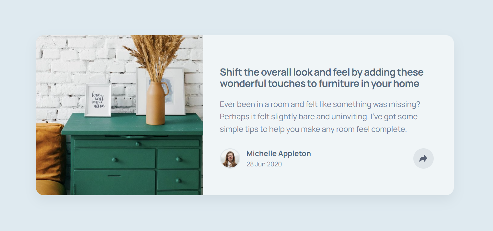

# Frontend Mentor - Article preview component solution

This is a solution to the [Article preview component challenge on Frontend Mentor](https://www.frontendmentor.io/challenges/article-preview-component-dYBN_pYFT). Frontend Mentor challenges help you improve your coding skills by building realistic projects. 

## Table of contents

- [Overview](#overview)
  - [The challenge](#the-challenge)
  - [Screenshot](#screenshot)
  - [Links](#links)
- [My process](#my-process)
  - [Built with](#built-with)
  - [What I learned](#what-i-learned)
  - [Continued development](#continued-development)
  - [Useful resources](#useful-resources)
  - [AI Collaboration](#ai-collaboration)
- [Author](#author)
- [Acknowledgments](#acknowledgments)




### Built with

- Semantic HTML5 markup
- CSS custom properties
- Flexbox
- CSS Grid
- Mobile-first workflow


```js
const card = document.querySelector('.card-2');
const shareButton = document.querySelector('.btn');

if (card && shareButton) {
  shareButton.addEventListener('click', (event) => {
    event.stopPropagation();
    const isOpen = card.classList.toggle('is-open');
    shareButton.classList.toggle('is-active', isOpen);
    shareButton.setAttribute('aria-expanded', String(isOpen));
  });
  
  document.addEventListener('click', (event) => {
    if (!card.contains(event.target)) {
      card.classList.remove('is-open');
      shareButton.classList.remove('is-active');
      shareButton.setAttribute('aria-expanded', 'false');
    }
  });
}

```

